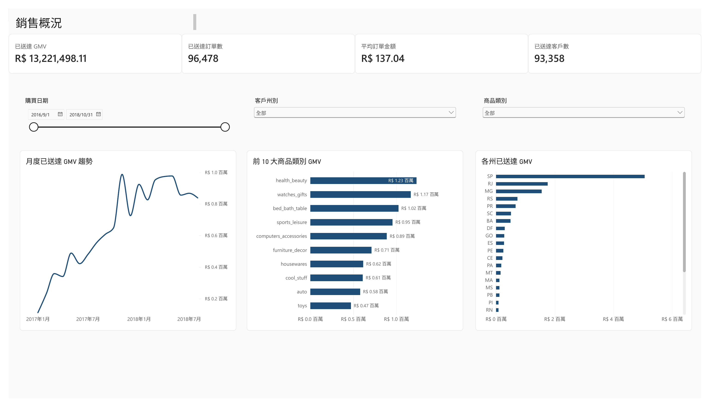
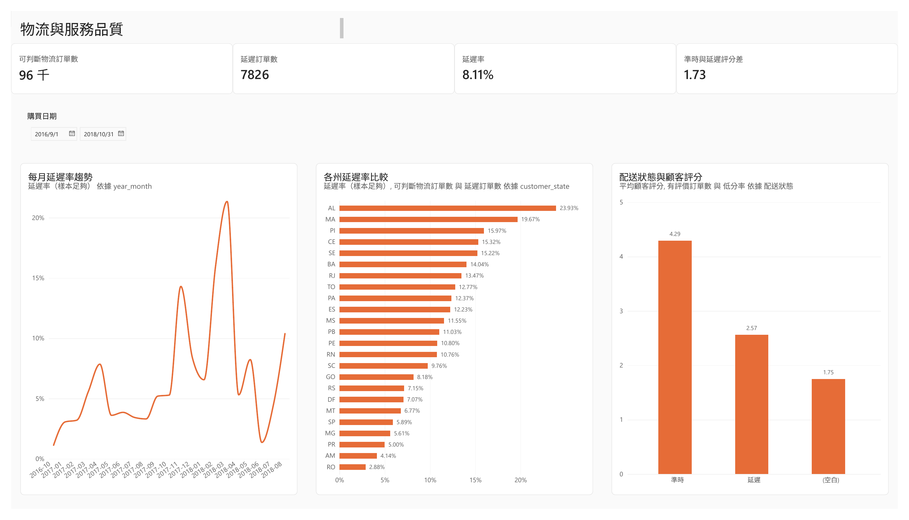

# Olist 電商銷售與物流分析

這份作品使用巴西 Olist 電商訂單資料，整理銷售表現、配送延遲與顧客評分。我希望回答兩個問題：哪些月份與地區的配送問題較明顯，以及延遲訂單的評分是否與準時訂單不同。

資料期間為 2016 年 9 月至 2018 年 10 月。報表使用 Power BI 製作，PostgreSQL 作為資料來源，Python 用來檢查資料品質並重算核心指標。

## 銷售概況

- 已送達訂單：96,478 筆
- 已送達 GMV：R$ 13,221,498.11
- 平均訂單金額：R$ 137.04
- 已送達客戶：93,358 人

`health_beauty`、`watches_gifts` 與 `bed_bath_table` 是 GMV 最高的三個商品類別。州別方面，`SP` 的 GMV 明顯高於其他地區，是主要營收市場。

## 物流與顧客評分

- 可判斷配送狀態的訂單：96,470 筆
- 延遲訂單：7,826 筆
- 整體延遲率：8.11%
- 準時訂單平均評分：4.29
- 延遲訂單平均評分：2.57

2018 年 3 月的延遲率為 21.36%，是樣本足夠月份中最高的一個月。州別比較中，`AL`、`MA` 與 `PI` 的延遲率較高，適合列為後續調查的優先順序。

準時與延遲訂單的平均評分相差約 1.73 分，低分率也有明顯差距。這表示配送狀態與顧客評分存在關聯，但僅憑這份歷史資料，不能直接判定延遲是低評分的唯一原因。

## Python 驗證

計算 KPI 前，我先確認資料是否適合分析：

- 檢查 `order_id` 是否唯一，避免同一張訂單被重複計算。
- 檢查缺失訂單 ID、重複列、負 GMV、異常評分與不合理日期。
- 將延遲率分母限定為已送達，且實際與預估送達日期皆完整的訂單。
- 重新計算已送達訂單數、GMV、月份與州別延遲率，以及準時和延遲訂單的評分差異。

99,441 筆訂單中沒有重複的 `order_id`。已送達訂單有 8 筆缺少實際送達日期，因此未納入延遲率分母。Python 重算結果與 Power BI 顯示的核心數字一致。

## 後續建議

- 先檢查高延遲月份的訂單量、促銷活動與承運量能。
- 針對高延遲率州別，同時觀察訂單量、配送距離與賣家組成，不只比較百分比。
- 將延遲率、平均評分與低分率放在同一套服務品質監控中。
- 再依賣家、商品類別與配送路線拆解，找出較具體的改善位置。

## 分析限制

- 本分析屬於歷史資料比較，只能說明關聯，不能證明因果關係。
- 月份與州別比較需要同時考慮樣本數。
- 2016 年 9 月及 2018 年 10 月不是完整月份，不適合直接與完整月份比較。

## 完整報表

[查看兩頁 Power BI 報表 PDF](Olist_PowerBI_Dashboard.pdf)
